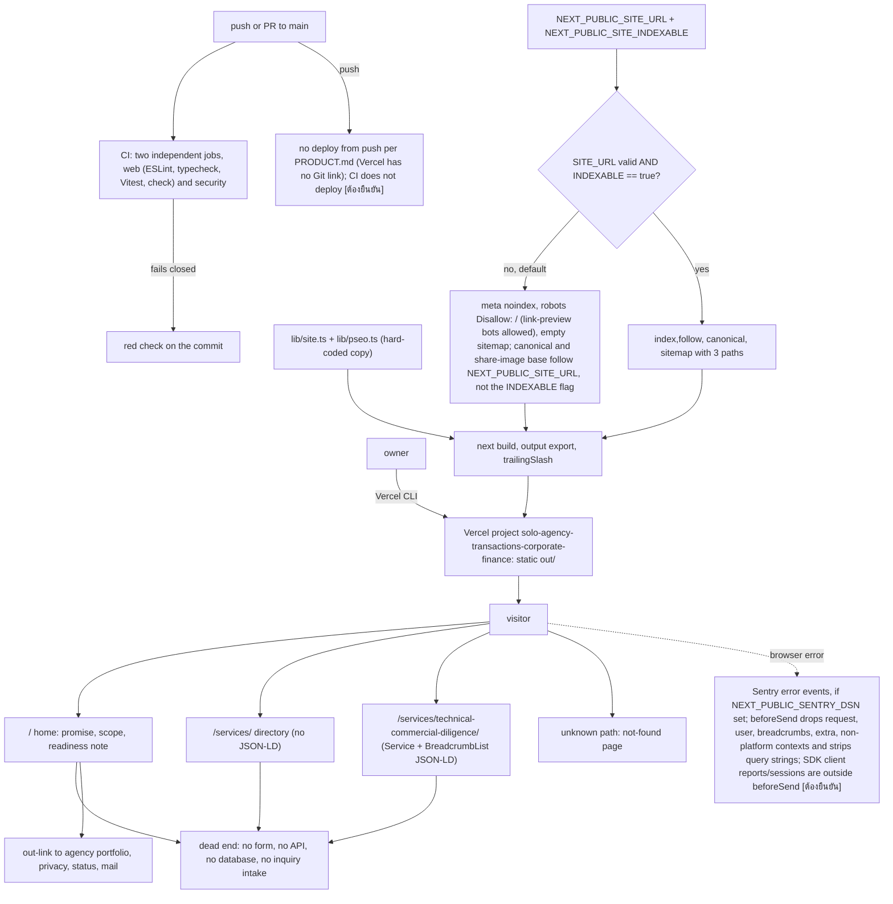
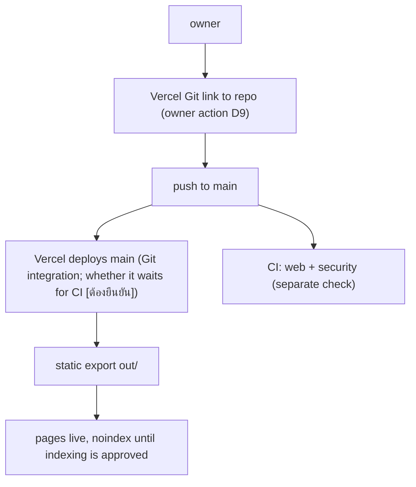

# 01 — Business process (As-Is / To-Be)

agency-transactions-corporate-finance-web คือเว็บ showcase แบบ static (Next.js `output: "export"`) ของกลุ่มงาน Transactions & Corporate Finance (สถานะ `target` / P2) มีหน้าแรกและหน้า service หน้าเดียว ใช้ทดสอบ positioning และ search intent โดยเจ้าของเท่านั้น ผู้เข้าชมอ่านได้อย่างเดียว ไม่มีฟอร์ม ไม่มี API ไม่มีฐานข้อมูล

Last reviewed: 2026-11-28 · commit `e9a3f7a`

## As-Is (จากโค้ดวันนี้)

Sources: `app/page.tsx`, `app/services/page.tsx`, `app/services/[slug]/page.tsx`, `app/robots.ts`, `app/sitemap.ts`, `lib/site-config.ts`, `lib/site.ts`, `lib/pseo.ts`, `lib/readiness.ts`, `components/pseo-page.tsx`, `components/site-links.tsx`, `next.config.ts`, `instrumentation-client.ts`, `lib/sentry.ts`, `.github/workflows/ci.yml`, `README.md`, `PRODUCT.md`

ข้อเท็จจริงสำคัญจากโค้ด:

- ข้อความทั้งหมดอยู่ในโค้ด (`lib/site.ts`, `lib/pseo.ts`) ไม่มีการอ่านข้อมูลตอนรัน; `generateStaticParams` ให้ service slug เดียว (`technical-commercial-diligence`) และ `dynamicParams = false` ดังนั้น path อื่นใต้ `/services/` เป็น 404
- `isIndexable` เป็นจริงเมื่อมี `NEXT_PUBLIC_SITE_URL` ที่ parse ผ่าน (http/https, ไม่มี query, fragment หรือ user:password) และ `NEXT_PUBLIC_SITE_INDEXABLE` เท่ากับ `true` พอดี ถ้าไม่ครบ ทุกหน้าเป็น `noindex, nofollow` และ sitemap ว่าง; canonical แยกจากเงื่อนไขนี้: มีเมื่อ `NEXT_PUBLIC_SITE_URL` ผ่านการ parse (แม้ไม่ได้เปิด index); ภาพ og/share ใช้ `NEXT_PUBLIC_SITE_URL` ถ้าไม่ใช่ loopback ไม่เช่นนั้นใช้โดเมน production ของ site เอง (`lib/site-config.ts`)
- sitemap ในโหมด index มี `/`, `/services`, `/services/technical-commercial-diligence` (ไม่มี trailing slash)
- social card คือ `public/og.png` (วาดโดย `scripts/og.mjs` แล้ว commit ไว้)
- CI มี 2 job อิสระต่อกัน (ไม่มี `needs`): `web` รัน ESLint + typecheck + Vitest (coverage gate 76%) + `npm run check` และ `security` (scan ที่ใช้ร่วมกัน) ซึ่งรันได้แม้ `web` ล้ม (`.github/workflows/ci.yml`); CI ไม่ deploy
- Sentry เปิดเฉพาะฝั่ง browser เมื่อมี DSN (`instrumentation-client.ts`, `lib/sentry.ts`) ไม่มี DSN คือปิด; `beforeSend` ลบ request/user/breadcrumbs/extra และ context ที่ไม่ใช่ข้อมูลแพลตฟอร์ม กับตัด query/hash ออกจากข้อความ ไม่ได้ลบข้อมูลอื่นทั้งหมด (stack trace และชื่อ error ยังส่ง); `beforeSend` ครอบเฉพาะ error event ส่วน client reports/session ของ SDK ไม่ผ่าน `beforeSend` และ `sentryOptions()` ไม่ได้ปิด [ต้องยืนยัน] ว่า production ส่งอะไรบ้าง
- การ deploy: `PRODUCT.md` (2026-10-23) บอกว่า project `solo-agency-transactions-corporate-finance` ไม่มี Git link และ deploy ด้วย Vercel CLI; ในโค้ดไม่มี deploy step จึงยืนยันสถานะวันนี้ไม่ได้ [ต้องยืนยัน]
- sitemap ใช้ path ไม่มี trailing slash ทั้งที่ `next.config.ts` ตั้ง `trailingSlash: true` (`app/sitemap.ts`) [ต้องยืนยัน] ว่าตั้งใจหรือไม่; มีผลเมื่อเปิด index เท่านั้น

## To-Be (จาก PRODUCT.md)

Sources: `PRODUCT.md` (Live URL and deploy state)

## Gap

| ID | As-Is → To-Be | Status | Owner | Evidence |
|---|---|---|---|---|
| G1 | deploy by Vercel CLI, `main` push does not deploy → Vercel Git link, push to `main` deploys | blocked | owner | `PRODUCT.md` (owner action D9, 2026-10-23) |
| G2 | noindex by default → owner decides when to set an approved `NEXT_PUBLIC_SITE_URL` and `NEXT_PUBLIC_SITE_INDEXABLE=true`. Inquiry intake is a separate matter: out of scope for this showcase (no lead collection), and the readiness gate in `lib/pseo.ts` must pass before any inquiry is accepted | decide | owner | `PRODUCT.md`, `lib/pseo.ts` (readiness), `AGENTS.md` (no lead collection); owner decision needed for indexing; no spec in repo |

## Open questions

- Vercel project `solo-agency-transactions-corporate-finance` ถูกเชื่อม Git แล้วหรือยัง และ production ตรงกับ `main` หรือไม่ (ต้องดูใน Vercel; ไม่มีใน repo) [ต้องยืนยัน]
